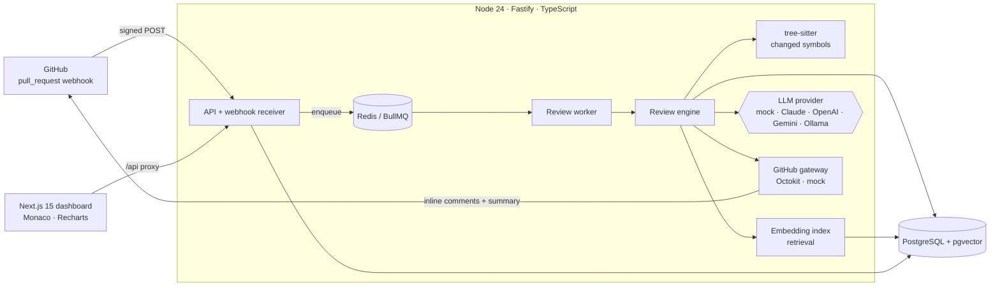
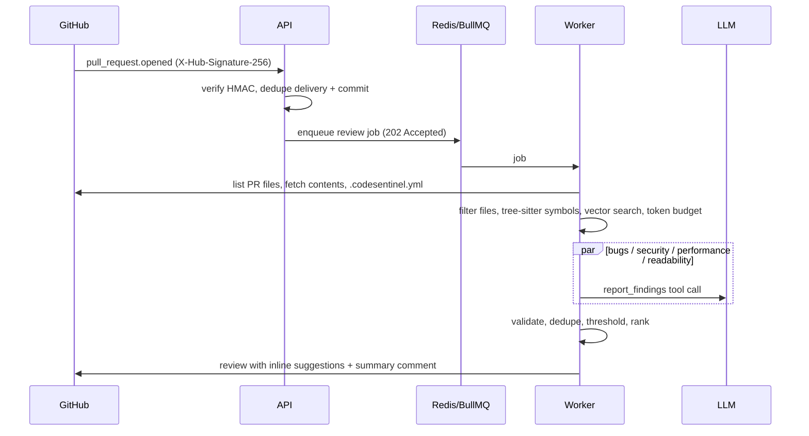
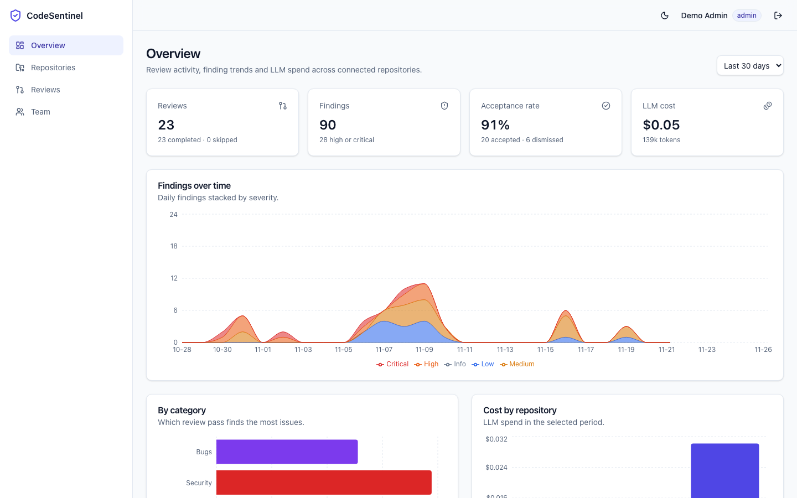
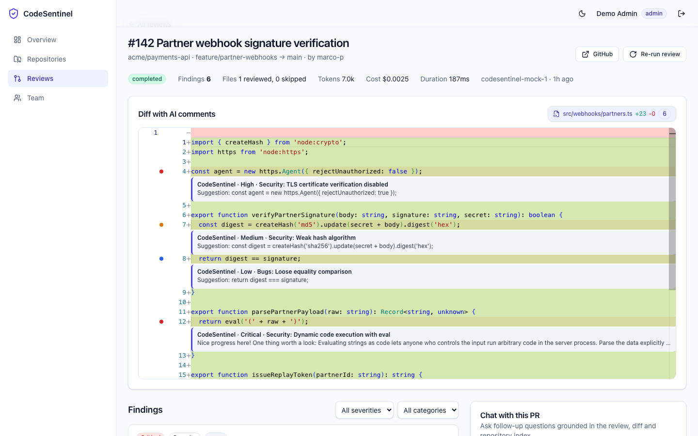
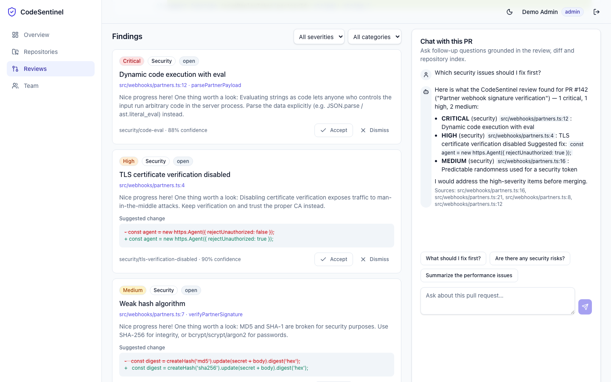
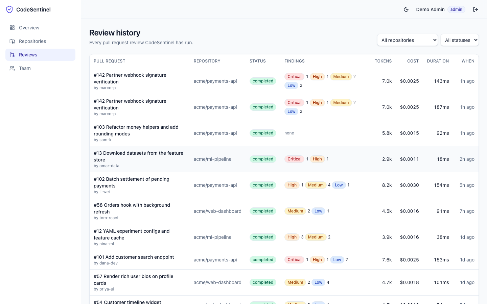
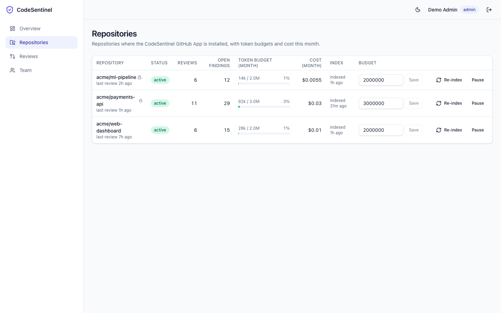
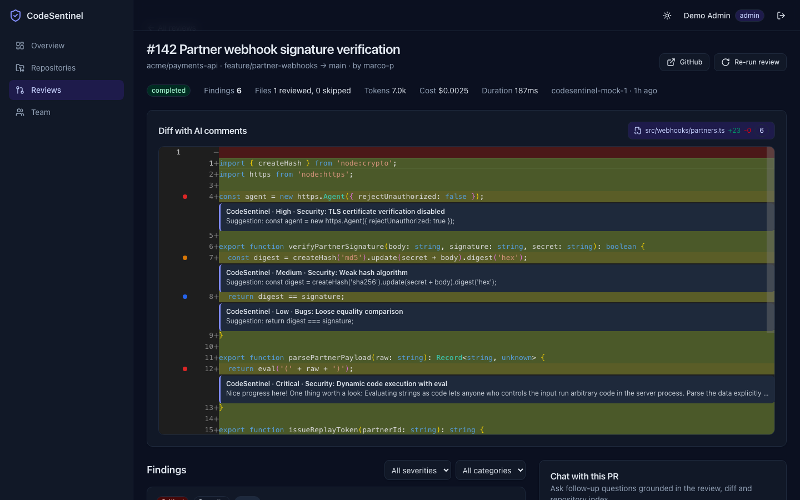

# CodeSentinel — AI Code Review GitHub App

CodeSentinel is a GitHub App and web dashboard that reviews every pull request with an LLM. It runs
four focused passes (bugs, security, performance, readability), posts inline review comments with
one-click GitHub `suggestion` blocks plus one summary comment, and tracks how many suggestions
developers actually accept. tree-sitter finds the changed functions, and a pgvector index of the
repository supplies related code as context.

The whole stack runs **offline with zero API keys**: a fixture-backed GitHub gateway and a
deterministic mock LLM are the defaults. Real providers (Anthropic Claude, OpenAI, Google Gemini,
Ollama) and a real GitHub App are selected with environment variables.

## Live demo

| | |
|---|---|
| **App** | [codesentinel-sigma.vercel.app](https://codesentinel-sigma.vercel.app) |
| **API docs** | [codesentinel-api-th9h.onrender.com/docs](https://codesentinel-api-th9h.onrender.com/docs) |
| **Health** | [codesentinel-api-th9h.onrender.com/api/health](https://codesentinel-api-th9h.onrender.com/api/health) |
| **Demo login** | click **Sign in with demo account** on the login page |

> Hosted on free tiers (Vercel + Render + Neon Postgres). The backend sleeps after 15 minutes idle, so the
> first request can take about a minute — open the health link first. Demo limits: mock GitHub and LLM providers; GitHub OAuth login is not configured.

## Features

- **GitHub App webhooks**: HMAC-SHA256 signature verification on the raw body, delivery-ID idempotency,
  one review per commit (unique constraint), BullMQ job queue with retries and crash recovery.
- **Code understanding**: unified-diff parsing, tree-sitter (WASM) symbol extraction for TS/JS/Python/Go/Java/Ruby/Rust,
  repository embedding index in pgvector (HNSW, cosine) for related-code retrieval.
- **Multi-pass LLM review** via function calling (`report_findings` tool). Each finding has severity, file, line,
  explanation and a suggested fix. Output is schema-validated, deduped, ranked and capped.
- **GitHub output**: inline review comments on RIGHT-side diff lines with `suggestion` blocks, plus a summary
  comment (severity table, top issues, skipped files, config errors, tokens and cost).
- **Per-repo `.codesentinel.yml`**: enable/disable passes, disable rule ids, team instructions, ignored paths,
  severity threshold, tone (friendly / neutral / strict), max findings, inline/summary toggles.
- **Dashboard**: connected repos, review history, findings over time by severity and category, top rules,
  acceptance rate, cost by repository.
- **Monaco diff viewer** with AI comments rendered inline (glyphs + view zones) and finding triage (accept / dismiss).
- **Chat with a PR**: follow-up questions grounded in the review findings, diffs and the repository index.
- **Cost control**: per-repo monthly token budgets checked *before* calling the LLM, per-call token limits,
  automatic skipping of lock files, vendored/minified/generated files and oversized diffs; usage and cost
  recorded per pass.
- **Deterministic offline mode**: mock LLM + mock GitHub so tests, seed data and CI need no secrets.
- **Production basics**: JWT access + rotating refresh tokens with reuse detection, GitHub OAuth, RBAC
  (admin / maintainer / viewer), Zod validation, structured pino logs with redaction, global error handling,
  rate limiting, security headers, health checks, OpenAPI docs, non-root containers.

## Architecture





## Tech stack

| Layer | Technology |
| --- | --- |
| Frontend | Next.js 15 (App Router), React 19, TypeScript, Tailwind CSS 4, shadcn/ui-style components, Monaco diff editor, Recharts, TanStack Query, next-themes |
| Backend | Node.js 24, Fastify 5, TypeScript, Zod (fastify-type-provider-zod), Drizzle ORM, pino |
| GitHub | GitHub App (Octokit REST + `@octokit/auth-app`), GitHub OAuth, webhook HMAC verification |
| AI | Pluggable LLM (official `@anthropic-ai/sdk` with `claude-opus-5-5`, OpenAI SDK, Gemini REST, Ollama), function calling, tree-sitter (web-tree-sitter WASM), embeddings (hashing / OpenAI / Ollama) |
| Data | PostgreSQL 17 + pgvector (HNSW), Redis 7 + BullMQ |
| Testing | Vitest (+ PGlite for real-SQL integration tests), Testing Library, Playwright |
| DevOps | Docker (multi-stage, non-root), Docker Compose, GitHub Actions, smee.io (local webhooks), Fly.io deploy guide |

## Screenshots

Captured from the seeded demo stack with [`scripts/screenshots.mjs`](scripts/screenshots.mjs) (1440x900, fixture data only).


_Overview: review volume, findings, acceptance rate and LLM cost, with findings over time stacked by severity._


_Review detail: Monaco diff of the PR with CodeSentinel findings rendered inline under the flagged lines._


_Findings with suggested changes and accept/dismiss triage, next to a grounded "chat with this PR" answer._


_Review history: every PR review with severity breakdown, tokens, cost and duration._


_Repositories: monthly token budget usage, cost, index status and admin budget controls._


_The review page in dark mode._

## Local setup

Prerequisites: Docker Desktop. For development without Docker: Node 20+ (24 recommended).

### Option A: everything in Docker (recommended)

```bash
cp .env.example .env          # optional; defaults are fully offline
docker compose up -d --build  # postgres, redis, backend, worker, seed, frontend
```

| Service | URL |
| --- | --- |
| Dashboard | http://localhost:20300 (sign in with the demo account) |
| API | http://localhost:20301 |
| OpenAPI docs | http://localhost:20301/docs |
| PostgreSQL | localhost:20310 (`codesentinel` / `codesentinel`) |
| Redis | localhost:20311 |

The `seed` service runs the real pipeline over fixture pull requests (3 repositories, ~20 reviews spread
over four weeks, simulated triage feedback and a sample chat). Then trigger a live review with a signed
webhook and run the scripted feature tour:

```bash
cd backend && npm run webhook:send -- --repo acme/payments-api --pr 142   # signed fixture webhook
./scripts/smoke.sh                                                         # end-to-end sample of every feature
cd frontend && npx playwright test                                         # browser e2e against the stack
docker compose down                                                        # stop (add -v to drop data)
```

### Option B: local processes

```bash
docker compose up -d postgres redis
cd backend && npm ci && npm run dev            # API on :3001 (migrates automatically)
npm run seed                                   # demo data
cd ../frontend && npm ci && BACKEND_INTERNAL_URL=http://localhost:3001 npm run dev   # :20300
```

Set `PORT=20301` for the backend to match the default `BACKEND_INTERNAL_URL`. For a zero-dependency backend run use
`DATABASE_DRIVER=pglite` (in-process Postgres with pgvector).

### Tests

```bash
cd backend && npm run lint && npm run typecheck && npm run test:coverage
cd frontend && npm run lint && npm run typecheck && npm test && npm run build
```

## Environment variables

All variables are validated at startup (Zod); invalid combinations fail fast with a clear message.
See [`.env.example`](.env.example) for the full list.

| Variable | Default | Description |
| --- | --- | --- |
| `LLM_PROVIDER` | `mock` | `mock`, `anthropic`, `openai`, `gemini`, `ollama` |
| `LLM_MODEL` | provider default | e.g. `claude-opus-5-5`, `gpt-4.1`, `gemini-2.5-pro`, `qwen2.5-coder:7b` |
| `ANTHROPIC_API_KEY` / `OPENAI_API_KEY` / `GEMINI_API_KEY` | — | Required for the chosen provider |
| `ANTHROPIC_EFFORT` | `medium` | Claude effort level |
| `LLM_TIMEOUT_MS` | `120000` | Per-call timeout; a timed-out pass does not fail the review |
| `EMBEDDING_PROVIDER` | `hash` | `hash` (offline), `openai`, `ollama` |
| `GITHUB_MODE` | `mock` | `mock` (fixtures) or `live` (real GitHub App) |
| `GITHUB_APP_ID`, `GITHUB_PRIVATE_KEY` | — | GitHub App credentials (required in `live`) |
| `GITHUB_WEBHOOK_SECRET` | dev value | Webhook HMAC secret |
| `GITHUB_CLIENT_ID`, `GITHUB_CLIENT_SECRET` | — | Enables "Continue with GitHub" OAuth login |
| `AUTH_DEV_LOGIN` | `true` | Demo login with a role picker; disable in production |
| `ADMIN_GITHUB_LOGINS` | — | GitHub logins promoted to admin (first user is admin) |
| `JWT_SECRET` | dev value | Must be changed when `NODE_ENV=production` |
| `DATABASE_URL`, `DATABASE_DRIVER` | compose values | Postgres URL; `pglite` for in-process DB |
| `REDIS_URL`, `QUEUE_MODE` | — / `inline` | `bullmq` uses Redis with a separate worker |
| `RUN_WORKER`, `WORKER_CONCURRENCY` | `true` / `2` | Consume jobs in the API process |
| `STALE_REVIEW_MINUTES` | `15` | Re-enqueue reviews stuck after a crash |
| `DEFAULT_MONTHLY_TOKEN_BUDGET` | `2000000` | Initial per-repo monthly budget |
| `MAX_FILE_CHANGED_LINES` | `1500` | Skip files with larger diffs |
| `MAX_REVIEW_INPUT_TOKENS` | `60000` | Per-call input limit (files are batched) |
| `CORS_ORIGINS`, `RATE_LIMIT_MAX` | `:20300` / `300` | CORS allow-list, requests per minute |

### `.codesentinel.yml`

```yaml
tone: friendly                 # friendly | neutral | strict
severity_threshold: low        # info | low | medium | high | critical
max_findings: 25
passes:
  readability: false           # bugs, security, performance, readability
ignore:
  - "docs/**"
  - "**/*.generated.ts"
rules:
  disabled: [bugs/loose-equality]
  instructions:
    - "All money values are integer cents; flag floating point arithmetic on amounts."
post_inline_comments: true
post_summary: true
```

## API docs

Interactive OpenAPI (Swagger UI) is served at **`/docs`** (`/docs/json` for the spec). Main endpoints:

| Method | Path | Auth |
| --- | --- | --- |
| POST | `/api/webhooks/github` | HMAC signature |
| GET | `/api/health` | public |
| POST | `/api/auth/dev-login`, `/api/auth/refresh`, `/api/auth/logout`; GET `/api/auth/github/login` | — |
| GET | `/api/repos`, `/api/repos/:id` | viewer |
| PATCH | `/api/repos/:id` (budget, pause) | admin |
| POST | `/api/repos/:id/reindex` | maintainer |
| GET | `/api/reviews`, `/api/reviews/:id` | viewer |
| POST | `/api/reviews/:id/rerun` | maintainer |
| GET/PATCH | `/api/findings`, `/api/findings/:id` | viewer / maintainer |
| GET | `/api/stats/overview?days=30` | viewer |
| GET/POST | `/api/pull-requests/:id/chat` | viewer |
| GET/PATCH | `/api/users`, `/api/users/:id` | admin |

## Deployment guide

### 1. Create the GitHub App
- Permissions: *Pull requests: Read & write*, *Contents: Read*, *Metadata: Read*, *Issues: Write* (summary comments).
- Subscribe to events: *Pull request*, *Installation*, *Installation repositories*.
- Webhook URL: `https://<your-api-host>/api/webhooks/github`, set a webhook secret.
- Generate a private key; for "Sign in with GitHub" create OAuth credentials with callback
  `https://<your-dashboard-host>/api/auth/github/callback`.

### 2. Local webhook forwarding with smee.io
```bash
npx smee-client --url https://smee.io/<channel> --target http://localhost:20301/api/webhooks/github
```
Use the smee URL as the App's webhook URL and set `GITHUB_MODE=live` plus the App credentials in `.env`.

### 3. Fly.io
```bash
fly postgres create --name codesentinel-db          # then: CREATE EXTENSION vector;
fly redis create                                    # Upstash Redis
cd backend
fly launch --name codesentinel-api --no-deploy      # uses backend/Dockerfile, internal port 3001
fly secrets set NODE_ENV=production JWT_SECRET=$(openssl rand -hex 32) COOKIE_SECURE=true AUTH_DEV_LOGIN=false \
  DATABASE_URL=... REDIS_URL=... QUEUE_MODE=bullmq RUN_WORKER=false GITHUB_MODE=live \
  GITHUB_APP_ID=... GITHUB_PRIVATE_KEY="$(cat app.pem)" GITHUB_WEBHOOK_SECRET=... \
  GITHUB_CLIENT_ID=... GITHUB_CLIENT_SECRET=... LLM_PROVIDER=anthropic ANTHROPIC_API_KEY=... \
  FRONTEND_URL=https://codesentinel-web.fly.dev CORS_ORIGINS=https://codesentinel-web.fly.dev
fly deploy
# worker as a second process group: in fly.toml add [processes] app="node dist/server.js" worker="node dist/worker.js"
cd ../frontend
fly launch --name codesentinel-web --no-deploy
fly deploy --build-arg BACKEND_INTERNAL_URL=http://codesentinel-api.internal:3001
```
Migrations run automatically on API start (`AUTO_MIGRATE=true`). Health check: `GET /api/health`.

## What I learned / Key engineering decisions

Full notes: [docs/DECISIONS.md](docs/DECISIONS.md).

- **Make the offline path the real path.** The mock LLM parses the same prompt and answers through the same
  tool-calling contract as Claude/GPT, and the mock GitHub gateway computes real unified diffs, so every test
  and the demo exercise prompt construction, validation and GitHub posting rather than stubs.
- **Never trust model output.** Findings are schema-validated, restricted to files in the prompt and to lines
  that exist, and only RIGHT-side diff lines get inline comments (GitHub rejects the rest). Prompts mark PR
  content as untrusted data to blunt prompt injection.
- **Budget before you spend.** Token estimates gate every review against a monthly per-repo budget; lock files,
  generated/minified files and huge diffs are skipped before any tokens are used.
- **Idempotency at the database, not in application checks.** A unique per-commit key makes concurrent webhook
  deliveries safe; engine runs are idempotent so BullMQ retries and crash recovery cannot duplicate findings.
- **Pin around ecosystem breakage.** `web-tree-sitter` 0.25+ cannot load the prebuilt grammar WASM files and
  newer PGlite releases moved pgvector out of the package; both are pinned and documented.
- **Real SQL in unit-speed tests.** PGlite with pgvector runs the real migrations in-process, so constraint,
  vector-search and analytics queries are covered without Docker.
